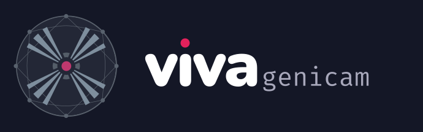

<p align="center">
  
</p>

<p align="center">
  Pure Rust building blocks for <b>GenICam</b>: <b>GigE Vision</b> and <b>USB3 Vision</b>.
</p>

<p align="center">
  <a href="https://github.com/VitalyVorobyev/viva-genicam/actions/workflows/ci.yml"></a>
  <a href="https://crates.io/crates/viva-genicam"></a>
  <a href="https://docs.rs/viva-genicam"></a>
  <a href="LICENSE"></a>
</p>

> **Status -- pre-1.0, and working.** Users have run discovery, control and
> streaming against real GigE Vision cameras from several vendors, on Linux,
> Windows and macOS. The protocol layers are implemented against the EMVA
> specifications and covered by automated tests against in-process fake
> cameras, and by a corpus of dozens of real vendor GenApi XML descriptions.
>
> What pre-1.0 means in practice: the API still changes between releases, and
> **there is no camera in CI** -- hardware confirmations come from users with
> their own devices. So a camera nobody has tried yet may well hit something. If
> yours does, [open an issue](https://github.com/VitalyVorobyev/viva-genicam/issues/new/choose):
> that is how camera-specific bugs here get found and fixed.

> **Disclaimer** -- Independent open-source Rust implementation of GenICam-related standards.
> Not affiliated with, endorsed by, or the reference implementation of EMVA GenICam.
> GenICam is a trademark of EMVA.

---

## Features

- **Discovery** -- find GigE Vision cameras via GVCP broadcast; USB3 Vision cameras via USB enumeration
- **Control** -- read and write device registers and GenApi features (Integer, Float, Enumeration, Boolean, Command, String, Register, SwissKnife, Converter, IntConverter)
- **Streaming** -- GigE: GVSP reassembly with backpressure, plus raw capture from event-vision cameras (packet resend is not wired into the receive path yet); U3V: async frame iterator over USB bulk reads

> **USB3 Vision has not met a camera yet.** It follows the GenCP standard and
> what independent implementations agree on, and is tested against a fake built
> from those sources, but no one has reported running it on real hardware. If
> you have a USB3 Vision camera, `viva-camctl report --usb 0 --out report.txt`
> attached to an issue is the most useful thing you can send.
- **IP configuration** -- FORCEIP for temporary assignment; persistent IP registers for permanent configuration
- **Events & actions** -- subscribe to camera events; trigger synchronized acquisition via action commands
- **Time & chunks** -- map device timestamps to host time; parse chunk data (timestamp, exposure, gain)
- **Service bridge** -- expose cameras over [Zenoh](https://zenoh.io/) for Viva Studio (the desktop GUI in `studio/`)
- **No hardware required** -- built-in fake cameras (`viva-fake-gige`, `viva-fake-u3v`) for testing and demos

## Which part do I need?

- **A Rust application** -- `cargo add viva-genicam`, the facade over the whole stack ([Quick start](#quick-start)).
- **Python** -- `pip install viva-genicam` ([Python](#python)).
- **A command line** -- `viva-camctl`, from the release archives or with the Python package ([viva-camctl CLI](#viva-camctl-cli)).
- **A desktop app** -- [Viva Studio](#viva-studio), from the release downloads.
- **Cameras over the network** -- `viva-service` / `viva-service-u3v` serve them over Zenoh ([viva-service](#viva-service-zenoh-bridge)).

Every crate, and what it is for, is listed in the book's
[Crates](https://vitalyvorobyev.github.io/viva-genicam/crates/) page.

## Viva Studio

A desktop app for GenICam cameras: find a camera, browse and change its
features, watch the live image, and save the diagnostic report we ask for. It
runs the library itself, so it is the quickest way to try viva-genicam on your
camera. Download it from the
[releases](https://github.com/VitalyVorobyev/viva-genicam/releases) — macOS
(Apple Silicon), Linux and Windows; the builds are unsigned, so the first
launch asks for confirmation. The book's
[Viva Studio](https://vitalyvorobyev.github.io/viva-genicam/studio.html) chapter
covers installing and using it.

## Quick start

```bash
cargo add viva-genicam
```

```rust
use viva_genicam::gige;
use std::time::Duration;

#[tokio::main]
async fn main() -> Result<(), Box<dyn std::error::Error>> {
    // Discover cameras on the network
    let devices = gige::discover(Duration::from_secs(1)).await?;
    println!("Found {} cameras", devices.len());

    // Connect to the first camera
    let mut camera = viva_genicam::connect_gige(&devices[0]).await?;

    // Read and write features
    let exposure = camera.get("ExposureTime")?;
    println!("ExposureTime = {exposure}");
    camera.set("ExposureTime", "5000")?;
    Ok(())
}
```

## Python

Pre-built wheels are published on PyPI — no C toolchain needed:

```bash
pip install viva-genicam
```

This also installs the [`viva-camctl`](#viva-camctl-cli) command, so the
diagnostics below are available without a Rust toolchain:

```bash
viva-camctl list
viva-camctl report --ip 192.168.0.10 --out viva-report.txt
```

```python
import viva_genicam as vg

cams = vg.discover(timeout_ms=500)
cam = vg.connect_gige(cams[0])
cam.set_exposure_time_us(10_000.0)

with cam.stream() as frames:
    for frame in frames:
        arr = frame.to_numpy()           # shape and dtype follow the pixel format
        break
```

The book's [Python chapter](https://vitalyvorobyev.github.io/viva-genicam/python.html) has the full Python API.

## Documentation

For users:

- **[User guide](https://vitalyvorobyev.github.io/viva-genicam/)** -- tutorials, networking, Python, Viva Studio, troubleshooting
- **[API reference (docs.rs)](https://docs.rs/viva-genicam)** -- the Rust API
- **[Examples](crates/viva-genicam/examples/)** -- runnable programs for discovery, streaming, events, chunks and more; the guide's Rust snippets come from them, so they compile in CI
- **[Reporting a camera we can't open](https://vitalyvorobyev.github.io/viva-genicam/reporting.html)** -- what to send us

For developers:

- **[CONTRIBUTING.md](CONTRIBUTING.md)** -- building, checks, tests, pull requests
- **[docs/](docs/README.md)** -- design, standards, decision records, roadmap and backlog

## Examples (from a clone of this repository)

```bash
# Discover cameras
cargo run -p viva-genicam --example list_cameras

# Read/write features
cargo run -p viva-genicam --example get_set_feature
cargo run -p viva-genicam --example get_set_feature -- --name Gain --value 3.0

# Fetch and inspect the camera's GenApi XML
cargo run -p viva-genicam --example fetch_xml

# Grab frames from the first camera found, on the host NIC you name
cargo run -p viva-genicam --example grab_gige -- --iface 192.168.0.5

# Zero-hardware demo (uses built-in fake camera)
cargo run -p viva-genicam --example demo_fake_camera
```

## viva-camctl CLI

The examples below use `cargo run` from a checkout. If you would rather not
build it, `pip install viva-genicam` installs the same CLI as a `viva-camctl`
command — the wheel links it in, so `viva-camctl report ...` works with no Rust
toolchain.

```bash
# Discover GigE Vision cameras
cargo run -p viva-camctl -- list

# Collect a diagnostic bundle to attach to a bug report
cargo run -p viva-camctl -- report --ip 192.168.0.10 --out viva-report.txt

# Dump the camera's GenApi XML (parses nothing, so it works on a camera we cannot open)
cargo run -p viva-camctl -- xml --ip 192.168.0.10 --out camera.xml

# Read a feature
cargo run -p viva-camctl -- get --ip 192.168.0.10 --name ExposureTime

# Write a feature
cargo run -p viva-camctl -- set --ip 192.168.0.10 --name ExposureTime --value 5000

# Stream frames. By default the camera's GevSCPSPacketSize is kept.
# --auto: set from NIC MTU, then path-probe / bisect. --packet-size N: explicit ceiling.
cargo run -p viva-camctl -- stream --ip 192.168.0.10 --iface 192.168.0.5 --auto --save 2
# Cap for a known narrow path (e.g. a switch that only forwards ~9K frames):
cargo run -p viva-camctl -- stream --ip 192.168.0.10 --iface 192.168.0.5 --packet-size 9000 --save 2

# Sustained streaming benchmark
cargo run -p viva-camctl -- bench --ip 192.168.0.10 --duration-s 60 --json-out bench.json

# Assign temporary IP via FORCEIP
cargo run -p viva-camctl -- set-ip --mac DE:AD:BE:EF:CA:FE --ip 192.168.1.100 --force

# Configure persistent IP
cargo run -p viva-camctl -- set-ip --mac DE:AD:BE:EF:CA:FE --ip 192.168.1.100

# Event-vision camera: append every EVT block to one file
cargo run -p viva-camctl -- stream --ip 192.168.0.10 --save 0 --raw-out capture.evt3 --duration-s 10

# USB3 Vision: discover, read/write features, stream
cargo run -p viva-camctl -- list-usb
cargo run -p viva-camctl -- get-usb --name ExposureTime
cargo run -p viva-camctl -- set-usb --name ExposureTime --value 5000
cargo run -p viva-camctl -- stream-usb --save 3
```

## viva-service (Zenoh bridge)

```bash
# Start the GigE Vision service
cargo run -p viva-service -- --iface en0

# Start the USB3 Vision service (real camera)
cargo run -p viva-service-u3v

# Start the USB3 Vision service with a fake camera
cargo run -p viva-service-u3v -- --fake
```

The service discovers cameras, publishes device announcements, serves GenICam XML,
handles node read/write, and streams frames over Zenoh for Viva Studio
(the desktop GUI in `studio/`).

## Developing

Build, test and contribution instructions are in
[CONTRIBUTING.md](CONTRIBUTING.md); everything runs without hardware, against
cameras simulated in-process.

## Troubleshooting

- **No devices found** -- check NIC/interface selection and host firewall (UDP broadcast on port 3956)
- **Frame drops at high FPS** -- enable jumbo frames, raise `SO_RCVBUF`, enable inter-packet delay
- **Windows** -- allow the program through the firewall and check NIC power settings; see the book's [Networking guide](https://vitalyvorobyev.github.io/viva-genicam/networking.html#22-windows)

## License

MIT -- see [LICENSE](LICENSE).
