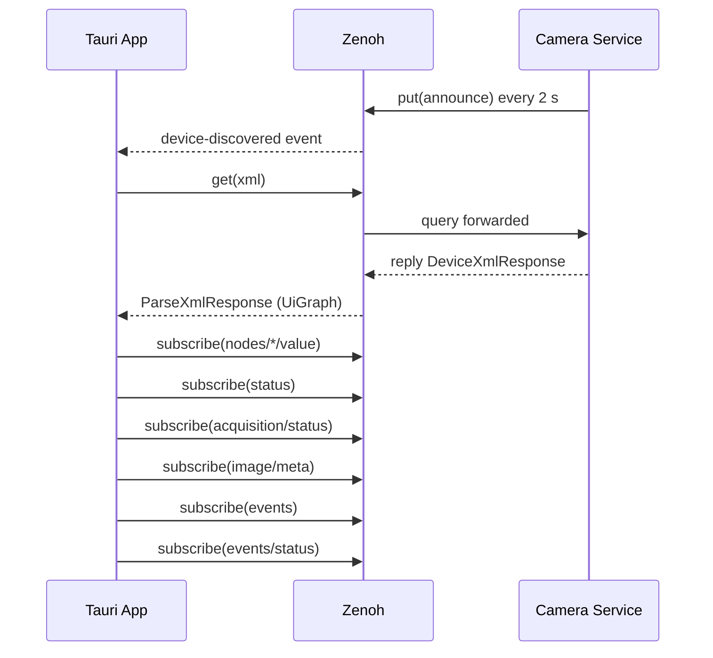
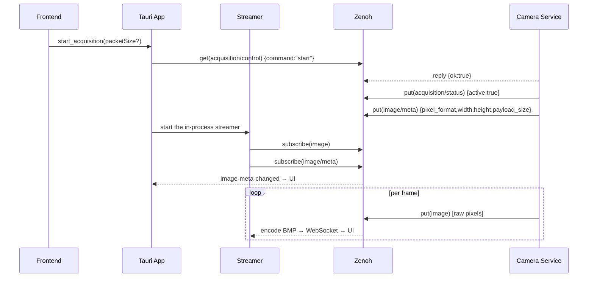

# Viva Studio — Zenoh API Contract

This document defines the Zenoh key schema, payload types, and interaction semantics
between the camera services (`viva-service`, `viva-service-u3v`) and Viva Studio
in remote mode — or any other client. The payload types are defined in
`viva-zenoh-api`.

## Key Naming Convention

All keys are prefixed with `genicam/devices/{device_id}/` where `device_id` is a short
stable identifier for the camera device (e.g., `cam0`, a serial-number slug, or any
opaque string without `/`).

---

## Discovery

### `genicam/devices/{device_id}/announce`

- **Direction:** Camera service → App
- **Mechanism:** `put` (publisher), periodic, e.g. every 2 seconds
- **Payload (JSON):**
  ```json
  {
    "id": "cam-000cdf065b2f",
    "name": "Left",
    "model": "SPC-3000",
    "serial": "SN12345678",
    "api_version": 8,
    "ip": "192.168.1.10",
    "mac": "00:0C:DF:06:5B:2F",
    "user_name": "Left",
    "manufacturer": "Sony"
  }
  ```
- **Rust type:** `DeviceAnnounce` in `viva-zenoh-api`
- **Semantics:** The app subscribes to `genicam/devices/*/announce`. Any device not seen
  for more than 6 seconds is considered lost and removed from the discovered list.
- **Identity:** for GigE Vision, `id` is `cam-` plus the MAC as lowercase hex
  (`viva_zenoh_api::gige_device_id`) — the one identifier that survives an address
  change. For USB3 Vision it is `cam-u3v-`, the vendor and product ids as hex, then
  the device's serial (`viva_zenoh_api::u3v_device_id`, `cam-u3v-164c5533-FF003089`),
  so a camera keeps its id on another port and identical cameras still differ; a
  camera without a serial falls back to its bus and address (`cam-u3v-1e10300a-2-7`),
  which a replug can change. Any byte other than a letter, a digit, `-` or `.` — `_` included — becomes `_` and two hex digits (`a/b` is `a_2fb`), so two serials never share an id. `name` is the user-defined name, else the model, else the address. `serial` is
  the device's own serial, empty when it reports none. `ip`, `mac`, `user_name` and `manufacturer` are optional and absent
  when unknown; USB3 Vision has no `ip` or `mac`. The app labels a device by its
  user-defined name, else serial, else address, so identical cameras stay distinguishable
  ([#137](https://github.com/VitalyVorobyev/viva-genicam/issues/137)).
- **`api_version`:** Optional. The app compares this against
  `viva_zenoh_api::API_VERSION` (currently `10`). On mismatch or absence, the app emits
  an `api-version-mismatch` Tauri event (see below) and still discovers the device — no
  hard rejection.

---

## Connection Lifecycle

### `genicam/devices/{device_id}/xml`

- **Direction:** App → Service (queryable GET)
- **Mechanism:** Zenoh queryable; app issues `get()` with empty payload
- **Response (JSON):**
  ```json
  { "xml": "<RegisterDescription>...</RegisterDescription>" }
  ```
- **Rust type:** `DeviceXmlResponse` in `viva-zenoh-api`
- **Semantics:** Full GenICam XML string. The app parses this into the UiGraph model on
  connect. Response should be stable during a session.

### `genicam/devices/{device_id}/report`

- **Direction:** App → Service (queryable GET)
- **Mechanism:** Zenoh queryable; the payload is optional
- **Request (JSON):**
  ```json
  { "include_xml": false }
  ```
  `include_xml` defaults to `true`, as does an empty payload.
- **Response (JSON):**
  ```json
  { "report": "# viva-genicam diagnostic report\n..." }
  ```
- **Rust types:** `DeviceReportRequest`, `DeviceReportResponse` in `viva-zenoh-api`
- **Semantics:** The plain-text diagnostic report `viva-camctl report` writes
  (`viva_genicam::report`), written by the service on the host the camera is
  attached to: the app may not reach the camera itself. Viva Studio's
  "Generate report" asks for it in remote mode. Served by `viva-service` and
  `viva-service-u3v`; the U3V service describes the camera it holds from what
  it read, since a USB device admits one owner (`ReportTarget::Open`).

### `genicam/devices/{device_id}/status`

- **Direction:** Service → App
- **Mechanism:** `put` on change
- **Payload (JSON):**
  ```json
  { "connected": true, "error": null }
  { "connected": false, "error": "USB link lost" }
  ```
- **Rust type:** `DeviceStatus` in `viva-zenoh-api`
- **Semantics:** App subscribes on connect. Loss of connection triggers
  `connection-state-changed` Tauri event.

---

## Node Values

### `genicam/devices/{device_id}/nodes/{node_name}/value`

- **Direction:** Service → App
- **Mechanism:** `put` on change (service-owned)
- **Payload (JSON):**
  ```json
  { "value": 1024, "access_mode": "RW" }
  { "value": "Continuous", "access_mode": "RW" }
  { "value": true, "access_mode": "RO" }
  { "value": 640, "access_mode": "RW", "min": 1.0, "max": 4096.0, "inc": 1.0 }
  ```
- **Rust type:** `NodeValueUpdate` in `viva-zenoh-api`
- **Semantics:** The app maintains a local `NodeValueCache` updated by these messages.
  `access_mode` is one of `RO`, `WO`, `RW`, `NA`.
  `min`, `max`, `inc` are **optional** runtime constraint hints When present,
  the UI can tighten slider ranges without re-parsing XML. Services that do not implement
  constraint propagation may omit them; the UI falls back to XML-parsed static constraints.

### `genicam/devices/{device_id}/nodes/{node_name}/set`

- **Direction:** App → Service (queryable GET)
- **Mechanism:** App issues `get()` with JSON payload
- **Request (JSON):**
  ```json
  { "value": 2048 }
  ```
- **Response (JSON):**
  ```json
  { "ok": true, "error": null, "invalidated": ["ExposureTime"] }
  { "ok": false, "error": "Value out of range" }
  ```
- **Rust type:** request: `NodeSetRequest`; response: `NodeOpResponse` — both in `viva-zenoh-api`
- **Semantics:** Synchronous write. On success the service publishes the new value to
  `nodes/{name}/value` and `nodes/{name}/state`. `invalidated` names the features the
  write may have changed (`viva_genapi::NodeMap::invalidated_by`): a selector's selected
  features, converters over the same register, features locked or gated by it. It is
  omitted when empty. The service names them rather than publishing their state,
  because there can be hundreds; a client re-reads the ones it shows.

### `genicam/devices/{device_id}/nodes/{node_name}/execute`

- **Direction:** App → Service (queryable GET)
- **Mechanism:** App issues `get()` with empty payload
- **Response (JSON):**
  ```json
  { "ok": true, "error": null }
  ```
- **Rust type:** `NodeOpResponse` in `viva-zenoh-api`
- **Semantics:** Executes a GenICam Command node. Like a write, a successful execute
  names what it invalidated — `UserSetLoad`, for instance, reaches every feature whose
  register names it as a `<pInvalidator>`.

### `genicam/devices/{device_id}/nodes/bulk/read`

- **Direction:** App → Service (queryable GET)
- **Request (JSON):** `{ "names": ["ExposureTime", "Gain", "Width"] }`
- **Response (JSON):**
  ```json
  {
    "values": {
      "ExposureTime": { "value": 10000.0, "access_mode": "RW" },
      "Gain":         { "value": 1.0,     "access_mode": "RW" }
    }
  }
  ```
- **Rust type:** request: `BulkReadRequest`; response: `BulkReadResponse` — both in `viva_zenoh_api`
- **Semantics:** Batch read of multiple node values in a single round-trip. Unknown node names are silently omitted. An empty `names` list returns an empty `values` map. The per-entry shape is identical to `nodes/{name}/value`.

### `genicam/devices/{device_id}/nodes/{node_name}/state`

- **Direction:** Service → App (subscribe) + App → Service (queryable GET)
- **Mechanism:** `put` on change **and** queryable reply
- **Payload (JSON):** a `FeatureState` object:
  ```json
  {
    "value": 1920,
    "access_mode": "RW",
    "kind": "Integer",
    "is_implemented": true,
    "is_available": true,
    "numeric": { "min": 16, "max": 4096, "inc": 8 },
    "unit": "px"
  }
  ```
  Enumeration nodes also carry `"enum_available": ["Off", "Once"]`. Every
  state carries `"caching"` — `"NoCache"`, `"WriteThrough"` or `"WriteAround"`,
  the feature's `<Cachable>` combined with that of the registers it is read
  through — and, when the feature or such a register declares a
  `<PollingTime>`, `"polling_ms"`: how long a client may show the value before
  reading it again ([ADR-0029](../adrs/adr0029-caching-polling-and-refresh.md)).
  A feature with nothing to read — a Category, a Command, a node declared
  `WO`, or the register a command writes through — carries `"value": null`
  and is never read from the device. It is still reported, with its access
  mode, so the client can offer the write or the execute:
  ```json
  { "value": null, "access_mode": "WO", "kind": "Command", "is_implemented": true, "is_available": true }
  ```
- **Rust type:** `FeatureState` in `viva_zenoh_api`
- **Semantics:** Authoritative live state of a feature, computed by `viva_genapi::NodeMap::feature_state` and converted with the `genapi` feature of `viva_zenoh_api` — the same computation Viva Studio's embedded mode uses. `access_mode` is what the feature permits now: the declared modes along its `<pValue>` chain combined (an `RW` integer over an `RO` register is `RO`), then `RO` while the feature is locked or unavailable, and `NA` when nothing is permitted. `min/max/inc` apply to the current selector context; `enum_available` is the set of entries the device reports as currently implemented/available. The service also publishes `nodes/{name}/value`, from the same `FeatureState` via `FeatureState::to_node_value_update`; prefer this key.

### `genicam/devices/{device_id}/nodes/bulk/state`

- **Direction:** App → Service (queryable GET)
- **Request (JSON):** `{ "names": ["ExposureTime", "PixelFormat", "Width"] }` (same shape as `BulkReadRequest`)
- **Response (JSON):** a `HashMap<String, FeatureState>`:
  ```json
  {
    "PixelFormat": {
      "value": "Mono8",
      "access_mode": "RW",
      "kind": "Enumeration",
      "is_implemented": true,
      "is_available": true,
      "enum_available": ["Mono8", "Mono16"]
    },
    "Width": {
      "value": 1920,
      "access_mode": "RW",
      "kind": "Integer",
      "is_implemented": true,
      "is_available": true,
      "numeric": { "min": 16, "max": 4096, "inc": 8 }
    }
  }
  ```
- **Rust type:** request: `BulkReadRequest`; response: `HashMap<String, FeatureState>` — types in `viva_zenoh_api`
- **Semantics:** Batch introspection. Names whose state cannot be built are silently omitted (same as `nodes/bulk/read`); write-only and command nodes are not among them — they are reported with `"value": null`.

### `genicam/devices/{device_id}/nodes/{node_name}/register`

- **Direction:** App → Service (queryable GET, no payload)
- **Response (JSON):** `{ "data": [86, 105, 118, 97] }` — the `<Register>` node's
  bytes, in the order the device holds them; an error reply, whose payload is the
  message, when the node is not a register or cannot be read now.
- **Rust type:** `RegisterData` in `viva-zenoh-api`
- **Semantics:** `Camera::get_register`: the whole register, however long. A
  register's `FeatureState` reports only its length
  (`{ "kind": "register", "length": 16 }`), since a register can be 100 000 bytes;
  its bytes are read here.

### `genicam/devices/{device_id}/nodes/{node_name}/register_set`

- **Direction:** App → Service (queryable GET)
- **Request (JSON):** `{ "data": [0, 1, 2, 3] }` — exactly the register's length.
- **Response (JSON):** a `NodeOpResponse`, as for `set`: `ok`, `error`, and on
  success `invalidated`, the features the write may have changed.
- **Rust type:** `RegisterWriteRequest` in `viva-zenoh-api`
- **Semantics:** `Camera::set_register`. Data of any other length is refused and
  nothing is written: a register is never padded or cut.

---

## Configuration

A camera's configuration is every feature its XML marks `<Streamable>`, as the text
of a GenApi feature file (ADR-0028) — the file `viva-camctl save` writes. The service
saves and restores it on its camera; the client reads and writes the file.

### `genicam/devices/{device_id}/configuration/save`

- **Direction:** App → Service (queryable GET, no payload)
- **Response (JSON):**
  ```json
  { "text": "# {05D8C294-F295-4dfb-9D01-096BD04049F4}\n...", "values": 42,
    "omitted": [ { "feature": "Gain[GainSelector=DigitalAll]", "reason": "not available" } ] }
  ```
- **Rust type:** `ConfigurationSaved` and `ConfigurationOmission` in `viva-zenoh-api`
- **Semantics:** `Camera::save_features`. A feature behind a selector is read under
  each entry, the selector put back after. `omitted` names what was left out and why,
  with the selector entries when only some values were; the file carries the same as
  comments. What `TLParamsLocked` locks is left out while the camera acquires.

### `genicam/devices/{device_id}/configuration/load`

- **Direction:** App → Service (queryable GET)
- **Request (JSON):** `{ "text": "<the file>" }`
- **Response (JSON):**
  ```json
  { "written": 40, "written_on_retry": 2,
    "failures": ["Gain[GainSelector=DigitalAll] = 99: <why>"],
    "warnings": ["<saved from another model or XML version>"] }
  ```
  An error reply, whose payload is the message, for a file that cannot be read at
  all (`line 1: ...`); nothing is written then.
- **Rust type:** `ConfigurationLoadRequest` and `ConfigurationLoaded` in `viva-zenoh-api`
- **Semantics:** `Camera::load_features`: values are written in the order the
  camera's dependencies require, a failed write is tried once more after the others,
  and every value still refused is in `failures`. Any feature may have changed
  afterwards, so a client re-reads what it shows.

---

## Acquisition

### `genicam/devices/{device_id}/acquisition/control`

- **Direction:** App → Service (queryable GET)
- **Mechanism:** App issues `get()` with JSON payload
- **Request (JSON):**
  ```json
  { "command": "start" }
  { "command": "start", "packet_size": 1400 }
  { "command": "stop" }
  ```
- **Response (JSON):**
  ```json
  { "ok": true, "error": null }
  ```
- **Rust type:** request: `AcquisitionControlRequest { command: AcquisitionCommand, packet_size: Option<u32> }`; response: `NodeOpResponse` — both in `viva-zenoh-api`. `packet_size`, for `start`, is the GVSP packet size to use as a ceiling the service's path probe stays under; absent, the service negotiates one from its NIC's MTU. `AcquisitionCommand` serializes as `"start"` or `"stop"` (`#[serde(rename_all = "lowercase")]`).
- **Semantics:** Start/stop hardware acquisition. On success the service begins/stops
  publishing to `image` — or to `evs`, for an event-vision camera. A `start` while
  acquiring is refused, unless the stream has ended by itself (its final status says
  `active: false`): then the service stops the old acquisition first.

### `genicam/devices/{device_id}/acquisition/status`

- **Direction:** Service → App
- **Mechanism:** `put` on start, every second while acquiring, and on stop
- **Payload (JSON):**
  ```json
  { "active": true, "fps": null, "stats": null }
  { "active": true, "fps": 241.0, "stats": { "frames_complete": 2410, "frames_incomplete": 0, "frames_missed": 3, "frames_backpressure": 0, "frames_unsupported": 0, "packets_received": 1205000, "packets_missing": 0, "packets_duplicate": 0, "packets_ignored": 0, "resend_requested": 0, "resend_recovered": 0, "resend_unavailable": 0, "transfer_errors": 0, "bytes": 740352000, "avg_mbps": 592.3, "avg_latency_ms": null, "elapsed_ms": 10004 } }
  { "active": false, "fps": null, "stats": { "frames_complete": 4820, "...": "..." } }
  { "active": false, "fps": null, "stats": null }
  ```
- **Rust type:** `AcquisitionStatus` and `StreamCounters` in `viva-zenoh-api`
- **Semantics:** The status sent on start has no counters. While acquiring, the
  frame loop sends one every second whether or not frames arrive, so the
  counters keep moving when the stream stalls: `fps` is the frames it
  delivered over that second, and `stats` the stream's counters since it
  started. When the stream ends, a final status with `active: false` carries
  its last counters (`AcquisitionStatus::stopped`); the status that follows,
  once the camera has stopped, carries none, and a client keeps the last
  counters it had.
- **Counters:** `StreamCounters` is `viva_genicam::StreamStats` on the wire,
  with the six reasons a packet goes unused summed into `packets_ignored`
  (`StreamStats::packets_ignored`) and the elapsed time in milliseconds.
  `frames_incomplete + frames_missed + frames_backpressure` is
  `StreamStats::frames_lost`. On USB3 Vision `packets_received` counts bulk
  transfers and `transfer_errors` the failed ones the stream recovered from;
  the other packet and resend counters stay 0.
- **Viva Studio:** embedded mode sends the same statuses as its
  `acquisition-status` event.

### `genicam/devices/{device_id}/image`

- **Direction:** Service → Streamer (NOT consumed by Tauri directly)
- **Mechanism:** `put` per frame
- **Payload:** 24-byte fixed [`FrameHeader`] prefix, bounded JSON frame metadata, then raw pixel data (row-major,
  no further encoding). The header makes every frame self-describing — consumers do not need to
  rely on a prior `image/meta` subscription.
- **Consumer:** the Tauri app's remote backend runs `viva_streamer`'s Zenoh source
  in-process while acquiring: it subscribes to this key and broadcasts BMP-encoded
  frames to the viewer over a local WebSocket.

#### Binary frame header layout (24-byte fixed prefix, all fields little-endian)

| Offset | Size | Field    | Description                                              |
|--------|------|----------|----------------------------------------------------------|
| 0      | 2    | `magic`  | `0x4746` LE (`[0x46, 0x47]`) — frame marker             |
| 2      | 1    | `version`| Header layout version; currently `3`                    |
| 3      | 1    | `format` | Pixel format discriminant (see table below)              |
| 4      | 4    | `width`  | Image width in pixels, `u32` LE                          |
| 8      | 4    | `height` | Image height in pixels, `u32` LE                         |
| 12     | 4    | `seq`    | Monotonically increasing frame counter, `u32` LE         |
| 16     | 4    | `stride` | Row stride in bytes, `u32` LE; `0` means continuous packing |
| 20     | 4    | `metadata_len` | JSON byte length, `u32` LE; at most 65,536 |

The JSON follows the prefix, then pixels begin at `24 + metadata_len`. Zero
length means no per-frame metadata. Otherwise the object is `FrameMetadata`:

```json
{
  "block_id": "18446744073709551615",
  "ts_dev": "9007199254740993",
  "ts_host_ns": null,
  "complete": true,
  "chunks": [{ "id": "42", "bytes": 8 }],
  "features": [{ "name": "ChunkTimestamp", "value": "9007199254740993", "error": null }],
  "chunk_error": null,
  "truncated": false
}
```

IDs and clock values are decimal strings to preserve all bits in JavaScript.
`ts_dev` is nullable raw ticks. `ts_host_ns` is nullable signed Unix nanoseconds
from device-clock calibration, never receipt time. Exactly one of a feature
value and error is present (the other is null). Chunk/feature lists retain at
most 128 items and descriptive strings at most 1,024 Unicode characters.
Oversized generated metadata is clipped with `truncated=true`; invalid remote
metadata is rejected, including malformed JSON, invalid decimal fields and
excessive lengths. See [ADR-0036](../adrs/adr0036-frame-metadata-with-pixels.md).

The stride belongs to this frame, not the separately published metadata. A
nonzero stride includes the pixel packing group and padding after each row,
including the final row; the payload contains at least `stride × height`
bytes. Services preserve those bytes and trim only data beyond the image. A
zero stride means pixels run continuously across row boundaries; PFNC owns
the packing rules, including supported partial final groups. Consumers pass
the declared stride to the shared PFNC converter instead of treating padding
as pixels.

Binary frame-header version 3 arrived with API version 8. Older image
headers are rejected; update services and Studio together. The one-byte pixel
format codes retain their existing meanings. Event-vision framing is unchanged.

#### Pixel format discriminant table

The byte says which PFNC format the pixels are in; what a format *is* —
its layout, its size — is `viva-pfnc`'s to say, and `image/meta` names it in
full. Codes are **only appended** — never reordered. A format without a code
travels as `0`, which decodes as `viva_pfnc::PixelFormat::Unknown(0)`.

| Code | PFNC format | PFNC code |
|------|-------------|-----------|
|    0 | none: a format without a code, or unset | — |
|    1 | `Mono8` | `0x0108_0001` |
|    2 | `Mono10` | `0x0110_0003` |
|    3 | `Mono12` | `0x0110_0005` |
|    4 | `Mono16` | `0x0110_0007` |
|    5 | `BayerRG8` | `0x0108_0009` |
|    6 | `BayerGR8` | `0x0108_0008` |
|    7 | `BayerBG8` | `0x0108_000B` |
|    8 | `BayerGB8` | `0x0108_000A` |
|    9 | `BayerRG10` | `0x0110_000D` |
|   10 | `BayerGR10` | `0x0110_000C` |
|   11 | `BayerBG10` | `0x0110_000F` |
|   12 | `BayerGB10` | `0x0110_000E` |
|   13 | `BayerRG12` | `0x0110_0011` |
|   14 | `BayerGR12` | `0x0110_0010` |
|   15 | `BayerBG12` | `0x0110_0013` |
|   16 | `BayerGB12` | `0x0110_0012` |
|   17 | `BayerRG16` | `0x0110_002F` |
|   18 | `BayerGR16` | `0x0110_002E` |
|   19 | `BayerBG16` | `0x0110_0031` |
|   20 | `BayerGB16` | `0x0110_0030` |
|   21 | `RGB8Packed` | `0x0218_0014` |
|   22 | `BGR8Packed` | `0x0218_0015` |
|   23 | `RGBa8` | `0x0220_0016` |
|   24 | `YCbCr422_8` | `0x0210_003B` |
|   25 | `YCbCr8` | `0x0218_005B` |
|   26 | `Coord3D_C16` | `0x0110_00B8` |
|   27 | `Mono14` | `0x0110_0025` |
|   28 | `Mono10p` | `0x010A_0046` |
|   29 | `Mono12p` | `0x010C_0047` |
|   30 | `Mono10Packed` | `0x010C_0004` |
|   31 | `Mono12Packed` | `0x010C_0006` |
|   32 | `BayerRG10p` | `0x010A_0058` |
|   33 | `BayerGR10p` | `0x010A_0056` |
|   34 | `BayerBG10p` | `0x010A_0052` |
|   35 | `BayerGB10p` | `0x010A_0054` |
|   36 | `BayerRG12p` | `0x010C_0059` |
|   37 | `BayerGR12p` | `0x010C_0057` |
|   38 | `BayerBG12p` | `0x010C_0053` |
|   39 | `BayerGB12p` | `0x010C_0055` |
|   40 | `BayerRG10Packed` | `0x010C_0027` |
|   41 | `BayerGR10Packed` | `0x010C_0026` |
|   42 | `BayerBG10Packed` | `0x010C_0029` |
|   43 | `BayerGB10Packed` | `0x010C_0028` |
|   44 | `BayerRG12Packed` | `0x010C_002B` |
|   45 | `BayerGR12Packed` | `0x010C_002A` |
|   46 | `BayerBG12Packed` | `0x010C_002D` |
|   47 | `BayerGB12Packed` | `0x010C_002C` |
|   48 | `BGRa8` | `0x0220_0017` |
|   49 | `YUV422_8` | `0x0210_0032` |
|   50 | `YUV422_8_UYVY` | `0x0210_001F` |
|   51 | `YCbCr422_8_CbYCrY` | `0x0210_0043` |
|   52 | `YUV411_8_UYYVYY` | `0x020C_001E` |
|   53 | `YUV8_UYV` | `0x0218_0020` |
|   54 | `YCbCr8_CbYCr` | `0x0218_003A` |

- **Rust types:** `FrameHeader`, `FrameHeaderError`, `FRAME_MAGIC`, `HEADER_SIZE`,
  `pixel_format_to_u8`, `u8_to_pixel_format` — all in `viva_zenoh_api::frame_header`;
  a header's `pixel_format` is a `viva_pfnc::PixelFormat`.

### `genicam/devices/{device_id}/image/meta`

- **Direction:** Service → App and Streamer
- **Mechanism:** `put` on acquisition start; re-published whenever Width, Height, or
  PixelFormat node values change while acquisition is active
- **Consumers:**
  - **The app's streamer** (`viva_streamer::zenoh_source`): subscribes to reconfigure
    its BMP encoder when dimensions or format change.
  - **Tauri app** (remote backend): forwards each update to the frontend as the
    `image-meta-changed` event.
- **Payload (JSON):**
  ```json
  { "pixel_format": "Mono8", "width": 1920, "height": 1080, "payload_size": 2073600 }
  ```
- **Rust type:** `ImageMeta` in `viva-zenoh-api`
- **Field notes:**
  - `pixel_format` — the format's PFNC name (`"Mono8"`, `"Mono12p"`,
    `"BayerRG8"`, `"RGB8Packed"`, `"Coord3D_ABC32f"`): any format `viva-pfnc`
    names, not a list of the wire's own. In Rust it is a `viva_pfnc::PixelFormat`;
    a name `viva-pfnc` does not know deserializes as `Unknown(0)` and is
    published as `"Unknown"`. Older names a camera may use (`"RGB8"`,
    `"YUV422Packed"`) are read as the same format.
  - `payload_size` — the bytes a frame's payload carries: the camera's
    `PayloadSize`, padding and chunk data included; without one,
    `width × height` at the format's PFNC size.

### `genicam/devices/{device_id}/evs`

- **Direction:** Service → subscribers (Studio does not consume it yet)
- **Mechanism:** `put` per event block
- **Payload:** 24-byte binary [`EvsHeader`] immediately followed by the encoded events,
  exactly as the camera sent them.
- **Semantics:** An event-vision camera (a LUCID Triton2 EVS streaming Prophesee EVT 3.0 or
  EVT 2.1, [#138](https://github.com/VitalyVorobyev/viva-genicam/issues/138)) sends events,
  not pixels. Its blocks go here and **never** on `image`: they have no image geometry, and
  the GVSP leader's Size X / Size Y do not describe one.
  Named `evs` rather than `events` so it cannot be confused with GenICam device events.

#### Binary event-block header layout (24 bytes, all fields little-endian)

| Offset | Size | Field         | Description                                            |
|--------|------|---------------|--------------------------------------------------------|
| 0      | 2    | `magic`       | `0x5645` LE (`[0x45, 0x56]`, `"EV"`) — event marker    |
| 2      | 1    | `version`     | Header layout version; currently `2`                   |
| 3      | 1    | `format`      | `0` Unknown, `1` EVT 3.0, `2` EVT 2.1; codes only appended |
| 4      | 4    | `seq`         | Event-block counter, from `0` per acquisition, `u32` LE |
| 8      | 8    | `timestamp`   | Device timestamp, `u64` LE; valid only if flag bit 0   |
| 16     | 4    | `payload_len` | Bytes of event data that follow, `u32` LE              |
| 20     | 1    | `flags`       | Bit 0: `timestamp` is present                          |
| 21     | 3    | reserved      | Zero                                                   |

- **Rust types:** `EvsHeader` (build with `EvsHeader::new`; `#[non_exhaustive]`),
  `EvsFormat`, `EvsHeaderError`, `EVS_MAGIC`, `EVS_HEADER_SIZE` — in
  `viva_zenoh_api::evs_header`. `EvsHeader::decode` rejects a message whose `payload_len`
  disagrees with the bytes that follow.

## Camera Events

GenICam device events — a GigE Vision camera's `EVENT`/`EVENTDATA` messages, a
USB3 Vision camera's `EVENT_CMD`s, such as `ExposureEnd` — not the event-vision
blocks on `evs`.

### `genicam/devices/{device_id}/events/control`

- **Direction:** App → Service (queryable GET)
- **Request (JSON):**
  ```json
  { "command": "start", "events": ["ExposureEnd", "FrameStart"] }
  { "command": "stop" }
  ```
- **Response (JSON):** an `EventMonitorStatus` (below); an error reply, whose
  payload is the message, when `start` fails — an unknown `EventSelector` entry, a
  read-only session, no `EventSelector` at all. The message names each setting the
  failed start's rollback could not restore.
- **Rust type:** `EventControlRequest { command: EventCommand, events: Vec<String> }`
  in `viva-zenoh-api`; `EventCommand` serializes as `"start"` or `"stop"`.
- **Semantics:** `start` turns `EventNotification` on for each named
  `EventSelector` entry and, for GigE Vision, points the camera's message channel
  at a socket the service binds; it replaces monitoring already on. `stop` ends
  forwarding and restores exactly the settings `start` changed
  (`Camera::restore_events`): each notification, the selectors, the message channel,
  and a USB3 Vision camera's EventEnable word. The service also stops and restores
  when it lets go of the camera, and when the event channel fails.

### `genicam/devices/{device_id}/events`

- **Direction:** Service → App
- **Mechanism:** `put` per event, while monitoring is on
- **Payload (JSON):**
  ```json
  { "event_id": "0x9001", "name": "ExposureEnd", "ts_dev": "123456789", "ts_host_ns": null,
    "stream_channel": 0, "block_id": "42",
    "features": [ { "name": "EventExposureEndFrameID", "value": "42", "error": null },
                  { "name": "EventExposureEndTimestamp", "value": "123456789", "error": null } ] }
  ```
- **Rust type:** `CameraEvent` and `EventFeature` in `viva-zenoh-api`
- **Fields:** 64-bit values are decimal strings. `name` is the `EventSelector`
  entry the ID belongs to (`Camera::event_name`), `null` when the XML does not say.
  `ts_host_ns` is the device time mapped through a fitted clock, `null` without one —
  never the time the event arrived. `stream_channel` and `block_id` are GigE
  Vision's; a USB3 Vision event has neither, and both are `null`. `features` are
  the features the event's port feeds (`Camera::event_features`), sorted, each with
  its value or its read error.
- **Viva Studio:** embedded mode sends the same payload as its `camera-event` event.

### `genicam/devices/{device_id}/events/status`

- **Direction:** Service → App
- **Mechanism:** `put` on every start and stop, and when monitoring stops by itself
- **Payload (JSON):**
  ```json
  { "active": true, "events": ["ExposureEnd"], "warnings": [] }
  { "active": false, "events": [], "warnings": ["EventNotification[ExposureEnd] was not restored: …"] }
  ```
- **Rust type:** `EventMonitorStatus` in `viva-zenoh-api`
- **Semantics:** `warnings` says why monitoring stopped by itself, and lists each
  setting stopping could not restore — a lost camera, lost control, a refused write.
  Empty means everything was restored. A client shows them; it never reports a stop
  with warnings as clean.
- **Viva Studio:** embedded mode sends the same payload as its
  `camera-events-status` event.

---

## Timing Guarantees

| Key | Expected frequency |
|-----|--------------------|
| `announce` | Every 2 s (informational) |
| `nodes/*/value` | On parameter change (up to ~100 Hz for fast nodes) |
| `acquisition/status` | On change |
| `image` | At acquisition frame rate |
| `evs` | Per event block, while an event-vision camera acquires |
| `events` | Per camera event, while event monitoring is on |
| `events/status` | On start and stop of event monitoring |
| `image/meta` | On acquisition start; on Width, Height, or PixelFormat change during active acquisition |

Device is considered lost if `announce` is not received for 6 seconds. Both
figures are constants in `viva-zenoh-api` — `ANNOUNCE_INTERVAL` and
`ANNOUNCE_EXPIRY` — which both services and Viva Studio use.

---

## Error Semantics

- All Zenoh `get()` calls to service queryables expect a single reply within 5 seconds,
  except `report` and the two `configuration` keys, which read or write the whole
  camera and are given 120 seconds.
- Timeout or Zenoh-level error → surfaced as `"Zenoh timeout or error"`.
- Service-level error → returned in `{ "ok": false, "error": "..." }` response body;
  `events/control` answers a failed `start` with an error reply instead, and
  `nodes/{name}/register` and `configuration/*` answer a failure with an error reply.
- The app never puts to `image` or `nodes/*/value` — those are service-owned.

---

## Sequence Diagrams

### Device Connect



### Acquisition



---

## Tauri IPC (App Internal)

Studio's own commands and events — the same in embedded and remote mode — are
not part of this contract. The commands are registered in
`studio/apps/viva-studio-tauri/src-tauri/src/main.rs`, and their payload and
event types are generated into
[`studio/ui/viva-studio-ui/src/generated/ipc.ts`](../../studio/ui/viva-studio-ui/src/generated/ipc.ts).
